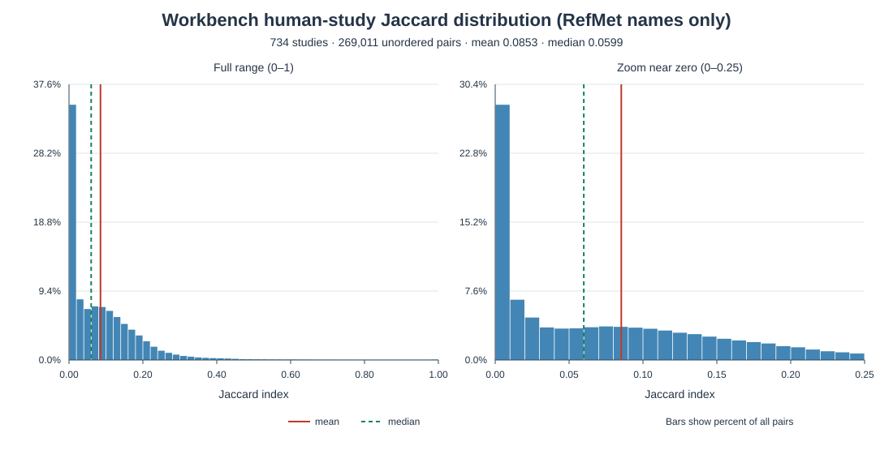

# Workbench human-study RefMet overlap

This is a **Metabolomics Workbench-only** analysis. It uses the Workbench `refmet_name` field only—no fallback names and no MetaboLights studies. The database and outputs contain only the human-study/sample evidence needed to audit inclusion, unique RefMet-name sets, pairwise scores, and summary statistics.

## Dataset

The full public Workbench summary corpus was refreshed through the API on 21 October 2026 (live run `20261021T111615Z`). It contained **4,646 studies**. The summary species field identified **1,903 human-tagged candidates**; sample records were inspected for those candidates. **1,890 studies** had at least one sample with human evidence. The remaining 13 candidates did not meet the sample rule and were excluded.

Among the 1,890 sample-verified human studies, **1,411 had at least one non-empty `refmet_name`**. After keeping only distinct, non-empty RefMet names, **734 studies had at least 100 names** and entered the pairwise comparison. This produced **269,011 unique unordered study pairs**.

## Results

| Measure | Result |
|---|---:|
| Eligible studies | **734** |
| Pairwise comparisons | **269,011** |
| Mean Jaccard overlap | **0.0853451** (**8.53%**) |
| Population variance (`ddof=0`) | **0.00935513** |
| Sample variance (`ddof=1`) | 0.00935516 |
| Median Jaccard overlap | 0.0599315 (**5.99%**) |
| Pairs with zero shared names | 36,226 (**13.47%**) |
| Score range | 0–1 |

For each pair of eligible studies, the Jaccard score is

```text
|RefMet names in both studies| / |RefMet names in either study|
```

The **mean of 8.53%** says that, averaged over all pairs, the studies share a modest fraction of the names in their combined RefMet-name sets. The median is lower (5.99%) than the mean, indicating a right-skewed distribution: most pairs overlap less, while a smaller number overlap much more. Some pairs have no shared names; a few have identical sets. The population variance describes the spread of all pair scores in this selected corpus; its square root is a standard deviation of about 9.67 percentage points. The plot shows the full 0–1 range and a zoom of the dense region near zero.



## Reproduce

One script performs the full workflow: refresh Workbench summaries; select human-tagged candidates; inspect samples; fetch metabolites only for sample-verified human studies; retain only non-empty `refmet_name` values; normalize names and apply the 100-name threshold; calculate every pair, mean, and variance; and write the database, CSVs, manifest, and plot.

Set up dependencies once, then run the script:

```bash
python3 -m venv .venv
.venv/bin/python -m pip install -r requirements.txt
.venv/bin/python run_refmet_only.py
```

The script uses a small, vendored Workbench-only subset of `metabo-search` 0.1.0 and does not call MetaboLights. It uses four workers and retries failed study inspections once. A live run may take several minutes and its results can change if Workbench records change. To keep the included snapshot untouched during a new live acquisition, use a new database filename, e.g. `.venv/bin/python run_refmet_only.py --database fresh_workbench_refmet_only.duckdb`.

To reproduce the **saved snapshot exactly**, without API calls, rebuild the pair table, summary, CSVs, and plot from its database records:

```bash
.venv/bin/python run_refmet_only.py --recompute 20261021T111615Z
```

## Files

- `run_refmet_only.py` — single end-to-end acquisition and analysis script; `--recompute` supports offline reproduction.
- `workbench_refmet_only.duckdb` — saved snapshot. Tables are `run_info`, `study`, `human_sample`, `study_refmet_name`, `pairwise_jaccard`, and `summary`.
- `eligible_studies.csv` — the 734 included studies and their counts.
- `refmet_name_sets.csv` — one unique RefMet name per eligible study/name key.
- `pairwise_jaccard.csv` — all pair scores, intersections, and unions.
- `summary.csv` — compact metric table.
- `manifest.json` — retrieval details, criteria, run ID, and summary metrics.
- `jaccard_distribution.svg` — histogram of the pairwise scores, with a near-zero zoom.
- `requirements.txt` — pinned direct dependencies.
- `vendor/metabo-search/` — only the Workbench client modules required by the script, with their source provenance and license.

## Caveats

- The initial candidate screen uses the Workbench summary `species` field. Sample inspection was limited to the 1,903 human-tagged candidates, so human studies missing that summary annotation may be absent. The 13 candidates without human-sample evidence were excluded.
- A study qualifies if it has at least one human sample. Workbench metabolite lists are study/analysis-level and may include identifications not specific to those human samples in mixed-species studies.
- The API field is `refmet_name` (a name, not a separate RefMet identifier). Only non-empty values are used; `metabolite_name` is never substituted. The 100-name threshold applies to distinct normalized RefMet names.
- Names are compared as text after Unicode NFKC normalization, whitespace collapsing, and case-folding. Synonyms, structures, or chemical identifiers are not reconciled, so chemically identical metabolites with different RefMet names remain different set elements.
- Live API results may change. The included database and `--recompute` mode preserve the exact snapshot used for the reported metrics.
